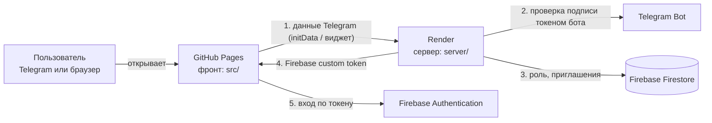

# Tutor TMA

Telegram Mini App для репетитора английского: расписание, путь ученика, колоды слов (мини-Anki), оплата. Два режима: **преподаватель** и **ученик**. Ученики заходят из Telegram, преподаватель — из Telegram или обычного браузера.

> **Статус.** Вход, роли и приглашения учеников — настоящие (Telegram + Render + Firebase). Данные (расписание, путь, колоды, оплата) пока лежат в `src/store/mock.js` — перенос в Firestore следующий шаг.

---

## Из чего состоит проект

| Часть | Где живёт | За что отвечает |
|---|---|---|
| **Фронт** (Vue 3 + Vite) | папка `src/`, хостится на **GitHub Pages** | весь интерфейс; собирается GitHub Actions при каждом push в `main` |
| **Сервер** (Node 20 + Express) | папка **`server/`**, хостится на **Render** | проверяет подпись Telegram, определяет роль, выдаёт Firebase-токен, создаёт приглашения |
| **База и вход** | **Firebase** (Firestore + Authentication) | хранит пользователей, роли и приглашения; принимает токен от сервера |
| **Бот** | **Telegram** (@BotFather) | открывает приложение, подписывает данные пользователя |



### Как проходит вход
1. Пользователь открывает приложение. Telegram передаёт фронту подписанные данные о нём (`initData`); в обычном браузере — то же самое через кнопку «Войти через Telegram».
2. Фронт отправляет их на сервер (`POST /auth/telegram` или `/auth/telegram-widget`).
3. Сервер проверяет подпись токеном бота — подделать пользователя без токена нельзя.
4. Сервер ищет пользователя в Firestore (`users/tg:<id>`):
   - id есть в `TEACHER_IDS` → **преподаватель**;
   - пользователь уже есть в базе → его сохранённая роль;
   - иначе, если открыта ссылка-приглашение (`startapp=invite_…`) и она не использована → создаётся **ученик**, ссылка гасится;
   - иначе **403, вход закрыт**.
5. Сервер возвращает Firebase custom token (в нём роль, имя, ник, фото). Фронт входит в Firebase; в браузере сессия сохраняется до «Выйти».

### Как ученик попадает в приложение
Преподаватель открывает карточку ученика → **«Пригласить в приложение»** → ссылка копируется → отправляет её ученику в Telegram → ученик открывает → его аккаунт привязывается к записи (ссылка одноразовая). Дальше он просто открывает бота, без ссылки.

---

## Все переменные: что и где задавать

Правило: **секреты (токен бота, ключ Firebase) — только на Render.** Всё, что задаётся на GitHub, попадает в публичный JS сайта, поэтому там только несекретные значения.

### GitHub → фронт
*Репозиторий → Settings → Secrets and variables → Actions → вкладка **Variables** → New repository variable.* Подставляются при сборке (`.github/workflows/deploy.yml`), поэтому после любого изменения нужно **перезапустить деплой** (Actions → Re-run).

| Variable на GitHub | Во фронте | Что это | Где взять |
|---|---|---|---|
| `API_URL` | `VITE_API_URL` | адрес сервера, **без `/` на конце**: `https://….onrender.com` | Render → сервис → верх страницы |
| `BOT_USERNAME` | `VITE_BOT_USERNAME` | ник бота без `@` (для кнопки входа в браузере) | @BotFather |
| `FIREBASE_API_KEY` | `VITE_FIREBASE_API_KEY` | web-конфиг Firebase | Firebase → ⚙ Project settings → Your apps → Web app → `apiKey` |
| `FIREBASE_AUTH_DOMAIN` | `VITE_FIREBASE_AUTH_DOMAIN` | там же | `authDomain` |
| `FIREBASE_PROJECT_ID` | `VITE_FIREBASE_PROJECT_ID` | там же | `projectId` |
| `FIREBASE_APP_ID` | `VITE_FIREBASE_APP_ID` | там же | `appId` |

Дополнительно: Settings → **Pages** → Source: **GitHub Actions**.

### Render → сервер (`server/`)
*Render → сервис → **Environment** → Add Environment Variable → «Save, rebuild, and deploy».*

| Переменная | Секрет? | Что это | Где взять |
|---|---|---|---|
| `BOT_TOKEN` | **да** | токен бота | @BotFather → `/mybots` → API Token |
| `BOT_USERNAME` | нет | ник бота без `@` | @BotFather |
| `FIREBASE_SERVICE_ACCOUNT` | **да** | весь JSON сервисного ключа (вставлять целиком) | Firebase → Project settings → Service accounts → Generate new private key |
| `TEACHER_IDS` | нет | Telegram id преподавателей (**цифры**, через запятую, не ник) | бот @userinfobot |
| `ALLOWED_ORIGIN` | нет | с каких адресов можно обращаться к серверу: `https://<ник>.github.io` (+ `,http://localhost:5173` для локальной проверки). **Только домен, без `/english-tma`, без `/` на конце, без пробелов** | адрес вашего сайта |
| `APP_SHORT_NAME` | нет | short name мини-приложения для ссылок-приглашений (если приложение создано через `/newapp`; если задано как Main Mini App — не нужна) | @BotFather → `/newapp` |
| `PORT` | — | Render задаёт сам | — |

Настройки сервиса на Render: **Root Directory** `server`, **Build** `npm install`, **Start** `npm start`, Auto-Deploy включён.

### Firebase → без переменных, но нужно включить
- **Firestore Database** — создать (режим production), правила взять из файла `firestore.rules` (Firestore → Rules → Publish).
- **Authentication** — нажать «Get started» (отдельные способы входа включать не нужно: вход идёт по токену от сервера).
- Коллекции создаются сервером сами: `users` (профиль и роль, `users/tg:<id>`), `invites` (одноразовые приглашения).

### Telegram (@BotFather)
- `/newapp` (или Menu Button) → URL: `https://<ник>.github.io/english-tma/` — по нему открывается приложение.
- `/setdomain` → `<ник>.github.io` — иначе кнопка «Войти через Telegram» в браузере не заработает.

### Локально (для разработки)
- Фронт: скопируйте `.env.example` → `.env.local` (в git не попадает), затем `npm install && npm run dev`. Вне Telegram включается демо-пользователь без входа.
- Сервер: `server/.env` с теми же переменными, что на Render, затем `cd server && npm install && npm run dev`.

---

## Настройка с нуля (чек-лист)
1. **Бот:** создать в @BotFather, записать токен и ник; `/newapp` с адресом сайта; `/setdomain`.
2. **Firebase:** создать проект → Firestore + Authentication → Web app (взять конфиг) → сервисный ключ → вставить правила из `firestore.rules`.
3. **Render:** New → Web Service из репозитория, Root Directory `server` → заполнить переменные из таблицы выше.
4. **GitHub:** заполнить Variables, включить Pages (Source: GitHub Actions), push в `main`.
5. **Проверка:** открыть приложение через бота; в логах Render появится `→ вход: tg:<id> @ник как teacher`, а в Firestore → `users` — ваша запись. Кнопка «Проверить связь с сервером» в «Профиле» преподавателя тоже пишет строку в логи.

## Структура репозитория
```
.github/workflows/deploy.yml   сборка фронта и публикация на GitHub Pages
src/                           фронт (Vue 3)
  composables/useTelegramAuth.js   вход: Telegram → сервер → Firebase
  store/mock.js                    данные-заглушки (расписание, путь, колоды)
  views/, components/              экраны и компоненты
server/                        сервер для Render
  index.js                         маршруты: /auth/*, /invites, /avatar, /sheets/csv, /ping
  telegram.js                      проверка подписи Telegram
firestore.rules                правила Firestore (вставляются в консоли Firebase)
.env.example                   шаблон переменных для локального запуска
```

## Частые проблемы
| Симптом | Причина и решение |
|---|---|
| «Сервер не отвечает» | В консоли браузера (F12) ошибка CORS → `ALLOWED_ORIGIN` на Render пуст или записан неточно (см. таблицу). Либо сервер спит (бесплатный Render, до 30 с) — повторить |
| «Не настроены переменные сервера и Firebase» | на GitHub нет `API_URL` / `FIREBASE_*` или после их добавления не перезапущен деплой |
| «Нет доступа» (403) | вас нет в `TEACHER_IDS` (нужен числовой id), либо ученик открыл не ссылку-приглашение / она уже использована |
| В логах `401` | подпись не прошла: `BOT_TOKEN` на Render от другого бота, чем тот, через которого открыто приложение |
| В логах `500` | проблема с Firebase: не создан Firestore или неверный `FIREBASE_SERVICE_ACCOUNT` |
| Нет кнопки входа в браузере | не выполнен `/setdomain` в @BotFather или не задан `BOT_USERNAME` |
| Приглашение не открывает приложение | не задан `APP_SHORT_NAME` (если приложение создано через `/newapp`) |
| Старая версия после деплоя | закрыть приложение в Telegram полностью; в браузере Ctrl+F5 |

Логи сервера: Render → сервис → **Logs**. Время последнего входа каждого пользователя: Firestore → `users` → поле `lastLoginAt`.

---

## Режим преподавателя
Вкладки: Главная (расписание + ученики) · Путь (пресеты пути) · Ученики (CRM) · Слова (Anki) · Профиль.

### Главная
- Две таблицы друг под другом (часы 08:00–22:00 × дни): сверху «Эта неделя», ниже «Следующая неделя». Листания нет — даты текущей и следующей недели подставляются сами.
- Ученика из списка справа (на телефоне — полоска сверху) перетаскивают в ячейку: в путь ученика добавляется урок `tutor` с `date` и `time` (`scheduleLesson` в `store/mock.js`).
- Урок в ячейке — карточка-аватарка. При перетаскивании «призрак» — копия карточки того же размера, лежащая ровно поверх оригинала и едущая за курсором (`dnd.grab` в `useDnd.js`, `DragGhost.vue`), поэтому карточка не прыгает.
- Урок можно перетащить в другую ячейку (занятая — обмен местами), на список учеников (урок снимается) или нажать на него — откроется шторка с действиями. Клик по пустой ячейке открывает выбор ученика.
- Обе таблицы работают одинаково: ученика или урок можно бросить в любую ячейку любой недели (занятую ячейку урок-на-урок меняет местами). Каждое действие даёт тост с «Отменить».
- Текущий час подсвечен красным в верхней таблице: время, день недели и ячейка на их пересечении.
- Перетаскивание — `src/composables/useDnd.js` на Pointer Events: мышь (сдвиг 5px) и касание (долгое нажатие ~220 мс; быстрый свайп — обычная прокрутка). Esc отменяет. Цели помечены `data-drop`.
- При подключении бэкенда замените `scheduleLesson / relocateLesson / swapLessons / removeLesson` вызовами API.

### Путь
- Вкладка «Путь» — только пресеты: переключатель пресетов, «+» (новый), переименование, «Копия», удаление, режим «Просмотр / Правка». В пресете нет дат.
- Кружки трёх типов: **ДЗ** (`hw`), **повторение слов** (`cards`), **слова + ДЗ** (`combo`; ученик сначала повторяет слова, потом отмечает ДЗ). Уроки (`tutor`) создаются расписанием.
- Правка: «Добавить кружок» (выбор типа) в конце юнита, красный × на кружке — удалить, нажатие на кружок — переименовать/сменить тип/колоду/текст ДЗ; юниты добавляются (`+ Юнит`), переименовываются, двигаются и удаляются. Удаления можно отменить тостом.
- Карточка ученика (вкладка «Ученики» или клик по ученику на главной): его колоды, «Добавить пресет» в путь (кружки датируются через день после последнего), «Сохранить путь как пресет» и тот же редактор кружков/юнитов.

### Слова (мини-Anki)
- Одинаковое приложение у преподавателя и ученика (`components/WordsApp.vue`); у преподавателя ещё права управления.
- Список колод со счётчиками Anki: **новые / изучаю / к повторению**, сводка (ответы сегодня, начато, выучено, график 7 дней).
- Сессия (`StudySession.vue`): «Показать ответ», «Снова / Трудно / Хорошо / Легко» с интервалами, «Отменить» последний ответ, лимит новых в день; клавиши: Пробел, 1–4, Z.
- Обозреватель карточек (`CardBrowser.vue`): поиск, фильтры, статус; преподаватель — добавить / править / скрыть из обучения / удалить.
- Колоды создаются по ссылке на Google Таблицу (A — слово, B — перевод, C — пример): «+ Колода» → вставить ссылку. «Обновить из таблицы» добавляет новые слова и обновляет переводы, прогресс не теряется. Запасной путь — вставить скопированные ячейки.
- Колода назначается «всем» или выбранным ученикам: в настройках колоды или в профиле ученика (блок «Колоды»).
- Прогресс хранится отдельно для каждого пользователя: `state.srs[userKey][cardId]`, `userKey` — `'teacher'` или id ученика (`composables/useSrs.js`).

### Профиль
- Вместо плитки с монетами — круг прогресса пути, рядом круг выученных слов (`WordsRing.vue`; выучено = интервал повторения ≥ 7 дней), он есть и у преподавателя. Аватарки: `Avatar.vue` показывает фото из Telegram (`photo_url`), иначе инициал. Своё фото берётся из `initDataUnsafe.user.photo_url`; фото учеников для преподавателя отдаёт бэкенд (`GET /avatar/:tgId`, пример — `server/avatar.example.js`; у ученика нужно поле `tgId`).

## Версии
- В «Профиле» внизу мелким текстом: `v0.2.0 · a1b2c3d` — версия и метка коммита. В GitHub Actions метку подставляет сам `GITHUB_SHA`, локально — `git`, без git будет `local` (`vite.config.js`, `AppVersion.vue`).
- Выпуск: поднимите `version` в `package.json`, допишите `CHANGELOG.md`, закоммитьте и поставьте тег: `git tag v0.2.0 && git push --tags` (на GitHub: Releases → Draft a new release → выбрать тег).

## Стиль
Duolingo: токены в `src/styles/theme.css` (цвета, толстые рамки, объёмные кнопки, шрифт Nunito), тёмная тема по Telegram/системе.
Окно Telegram Desktop для мини-приложений узкое (размером управляет клиент); кнопка «Полный экран» удалена из проекта.
Демо-переключатель ролей — во вкладке «Профиль»; сразу открыть режим преподавателя: `?demo&role=teacher`.
Данные: `src/store/mock.js` — students, paths[studentId], presets[], decks[].cards[], srs[userKey][cardId], log.
`vite.config.js` содержит `base: '/english-tma/'`: локально приложение открывается по http://localhost:5173/english-tma/.
Деплой: Settings → Pages → Source: GitHub Actions; workflow лежит в `.github/workflows/deploy.yml`.