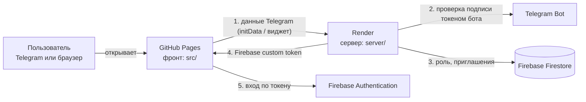

# Tutor TMA

Telegram Mini App для репетитора английского: расписание, путь ученика, колоды слов (мини-Anki), оплата. Два режима: **преподаватель** и **ученик**. Ученики заходят из Telegram, преподаватель — из Telegram или обычного браузера.

> **Статус.** Всё настоящее и хранится в Firestore через сервер (Telegram + Render + Firebase): вход, роли, ученики, приглашения, оплата, **расписание, путь учеников, пресеты, колоды слов с карточками и прогресс повторений**. Правки преподавателя сохраняются сами (автосохранение с паузой ~0,7 с). Данные в памяти остались только в `npm run dev` вне Telegram (демо).

---

## Из чего состоит проект

| Часть | Где живёт | За что отвечает |
|---|---|---|
| **Фронт** (Vue 3 + Vite) | папка `src/`, хостится на **GitHub Pages** | весь интерфейс; собирается GitHub Actions при каждом push в `main` |
| **Сервер** (Node 20 + Express + TypeScript) | папка **`server/`**, хостится на **Render** | проверяет подпись Telegram, определяет роль, выдаёт Firebase-токен, создаёт приглашения |
| **База и вход** | **Firebase** (Firestore + Authentication) | хранит пользователей, роли, учеников и приглашения; принимает токен от сервера |
| **Бот** | **Telegram** (@BotFather) | открывает приложение, подписывает данные пользователя |



**Сайт не обращается к Firestore напрямую.** Все данные (ученики, приглашения, роли) идут через сервер на Render: он проверяет токен и роль и работает с базой через Admin SDK. Firebase на сайте нужен только для входа по токену. Правила Firestore закрывают базу от всех клиентов.

### Как проходит вход
1. Пользователь открывает приложение. Telegram передаёт фронту подписанные данные о нём (`initData`); в обычном браузере — то же самое через кнопку «Войти через Telegram».
2. Фронт отправляет их на сервер (`POST /auth/telegram` или `/auth/telegram-widget`).
3. Сервер проверяет подпись токеном бота — подделать пользователя без токена нельзя.
4. Сервер ищет пользователя в Firestore (`users/tg:<id>`):
   - id есть в `TEACHER_IDS` → **преподаватель**;
   - пользователь уже есть в базе → его сохранённая роль;
   - иначе, если открыта ссылка-приглашение (`startapp=invite_…`) на существующего (не архивного) ученика и она не использована → создаётся **ученик**, привязанный к своей записи в `students`; ссылка гасится;
   - иначе **403, вход закрыт**.
5. Сервер возвращает Firebase custom token (в нём роль, имя, ник, фото). Фронт входит в Firebase; в браузере сессия сохраняется до «Выйти».

## Ученики и приглашения

### Как добавить ученика
1. **Ученики → «+ Добавить ученика»**: имя, уровень, размер пакета уроков. **Ник Telegram вводить не нужно.**
2. После «Добавить» в Firestore создаётся запись ученика (`students/<id>`), а сервер создаёт **ссылку-приглашение**.
3. Нажмите «Копировать» или «Отправить в Telegram» (откроется выбор контакта с готовым текстом) — **ссылку отправляете вы сами**, как обычное сообщение.
4. Ученик нажимает на ссылку в Telegram → открывается приложение → его аккаунт **привязывается к этой записи**. Сразу появляется его документ `users/tg:<id>` (роль `student`), а в списке бейдж «Ждёт приглашения» меняется на «В приложении».
5. Дальше ученик просто открывает бота — **ссылка больше не нужна**.

### Почему ссылка, а не ник
- **Бот не может написать первым.** Telegram запрещает ботам отправлять сообщения тому, кто с ними не взаимодействовал, поэтому приглашение всегда отправляете вы (или ваш аккаунт), а не бот. Когда ученик один раз открыл приложение, бот сможет писать ему сам (напоминания об уроках и оплате — позже).
- **Ник ненадёжен:** его можно сменить, освободить, занять чужому. Ссылка содержит уникальный одноразовый код, привязанный именно к этой записи.

### Правила ссылки
- **Одноразовая:** её привязывает первый аккаунт, который её открыл. Второй получит отказ («Нет доступа»). Отправляйте только самому ученику, не в общий чат.
- **Открывать нужно в Telegram.** Приложение откроется, только если в вашем боте настроено мини-приложение (`APP_SHORT_NAME`, см. переменные).
- **Вы сами себя не проверите:** ваш id в `TEACHER_IDS`, поэтому по ссылке вы войдёте как преподаватель, а приглашение останется неиспользованным. Для проверки нужен второй аккаунт Telegram.
- **Потерялась ссылка или ученик сменил аккаунт:** в карточке ученика кнопка «Пригласить в приложение» / «Привязать другой аккаунт» создаёт новую ссылку. Когда её откроют, запись переключится на новый аккаунт, а **старый аккаунт сразу теряет доступ**.

### Архив
Карточка ученика → «Архивировать ученика» (двойное нажатие). Ученик скрывается из списков, его аккаунт теряет доступ (документ `users/tg:<id>` удаляется), неиспользованные приглашения гасятся. Данные не удаляются: вернуть ученика можно вручную в Firebase → Firestore → `students/<id>` → поле `archived` = `false` (после этого нужно выдать новое приглашение).

### Что хранится в Firestore
| Коллекция | Документ | Кто пишет | Содержимое |
|---|---|---|---|
| `users` | `tg:<Telegram id>` | сервер | роль (`teacher` / `student`), `studentId`, имя, ник, фото, `lastLoginAt` |
| `students` | автоматический id | сервер | имя, уровень, цвет, оплата, `status` (`invited` / `active`), `tgId`, фото, `archived` |
| `invites` | случайный код | сервер | `studentId`, кто создал, `usedBy` (кто использовал) |
| `lessons` | автоматический id | сервер | **урок**: `date`, `hour`, `weekStart`, `studentIds` (массив: один ученик или группа), кто создал |
| `schedule` | понедельник недели (`2026-10-26`) | сервер | **неделя**: `weekStart` и `slots` — карта «дата_час → id урока» (ключ вида `2026-10-27_18`) |
| `paths` | id ученика | сервер | **путь ученика**: `units[]` (юниты) → `nodes[]` (кружки: `type` `tutor` / `hw` / `cards` / `combo`, `title`, `xp`, `done`, `date`, `time`, `desc`, `deckId`) |
| `presets` | id, придуманный сайтом | сервер | **пресет пути** (заготовка без дат): `name`, `units[]`; общие для всех преподавателей |
| `decks` | id, придуманный сайтом | сервер | **колода слов**: `title`, `forAll` / `assigned[]` (кому доступна), `newPerDay`, `source` (Google Таблица), `cards[]` (`front`, `back`, `example`, `suspended`) |
| `srs` | id ученика или `teacher_<uid>` | сервер | **прогресс повторений** одного пользователя: `cards` (id карточки → `ease`, `interval`, `reps`, `lapses`, `first`, `last`, `due`) и `log` (день → число ответов) |

Все девять коллекций пишет и читает **только сервер**; правила Firestore (`firestore.rules`) закрывают их от клиентов полностью. Доступ определяет сервер по роли в токене: преподаватель получает всех активных учеников, ученик — **только свою** запись (и только пока она привязана к его аккаунту), остальные — ничего.

Обновление списка: realtime нет, поэтому список перечитывается после входа, после каждого действия, при возврате в приложение и при открытии вкладки «Ученики». Бесплатный Render засыпает, и первое действие после паузы может занять до ~30 секунд.

### Демо-ученики
Мария, Леня и остальные из `src/store/demo.ts` показываются **только в `npm run dev`** вне Telegram. В боевой версии список учеников приходит с сервера (из Firestore), и пока никого нет, вы видите пустое состояние с подсказкой. Кнопка «Я ученик» (просмотр глазами ученика) доступна, когда есть хотя бы один ученик.

---

## Все переменные: что и где задавать

Правило: **секреты (токен бота, ключ Firebase) — только на Render.** Всё, что задаётся на GitHub, попадает в публичный JS сайта, поэтому там только несекретные значения.

### GitHub → фронт
*Репозиторий → Settings → Secrets and variables → Actions → вкладка **Variables** → New repository variable.* Подставляются при сборке (`.github/workflows/deploy.yml`), поэтому после любого изменения нужно **перезапустить деплой** (Actions → Re-run).

| Variable на GitHub | Во фронте | Что это | Где взять |
|---|---|---|---|
| `API_URL` | `VITE_API_URL` | адрес сервера, **без `/` на конце**: `https://….onrender.com` | Render → сервис → верх страницы |
| `BOT_USERNAME` | `VITE_BOT_USERNAME` | ник бота без `@` (для кнопки входа в браузере) | @BotFather |
| `FIREBASE_API_KEY` | `VITE_FIREBASE_API_KEY` | web-конфиг Firebase | Firebase → ⚙ Project settings → Your apps → Web app → `apiKey` |
| `FIREBASE_AUTH_DOMAIN` | `VITE_FIREBASE_AUTH_DOMAIN` | там же | `authDomain` |
| `FIREBASE_PROJECT_ID` | `VITE_FIREBASE_PROJECT_ID` | там же | `projectId` |
| `FIREBASE_APP_ID` | `VITE_FIREBASE_APP_ID` | там же | `appId` |

Дополнительно: Settings → **Pages** → Source: **GitHub Actions**.

### Render → сервер (`server/`)
*Render → сервис → **Environment** → Add Environment Variable → «Save, rebuild, and deploy».*

| Переменная | Секрет? | Что это | Где взять |
|---|---|---|---|
| `BOT_TOKEN` | **да** | токен бота | @BotFather → `/mybots` → API Token |
| `BOT_USERNAME` | нет | ник бота без `@` | @BotFather |
| `FIREBASE_SERVICE_ACCOUNT` | **да** | весь JSON сервисного ключа (вставлять целиком) | Firebase → Project settings → Service accounts → Generate new private key |
| `TEACHER_IDS` | нет | Telegram id преподавателей (**цифры**, через запятую, не ник) | бот @userinfobot |
| `ALLOWED_ORIGIN` | нет | с каких адресов можно обращаться к серверу: `https://<ник>.github.io` (+ `,http://localhost:5173` для локальной проверки). **Только домен, без `/english-tma`, без `/` на конце, без пробелов** | адрес вашего сайта |
| `SCHEDULE_TZ` | нет | часовой пояс, по которому считаются «эта» и «следующая» неделя (например `Europe/Moscow`); по умолчанию `Europe/Warsaw` | список часовых поясов IANA |
| `APP_SHORT_NAME` | нет | short name мини-приложения для ссылок-приглашений (если приложение создано через `/newapp`; если задано как Main Mini App — не нужна) | @BotFather → `/newapp` |
| `PORT` | — | Render задаёт сам | — |

Настройки сервиса на Render: **Root Directory** `server`, **Build** `npm install --include=dev && npm run build`, **Start** `npm start`, Auto-Deploy включён.

### Firebase → без переменных, но нужно включить
- **Firestore Database** — создать (режим production), правила взять из файла `firestore.rules` (Firestore → Rules → Publish).
- **Authentication** — нажать «Get started» (отдельные способы входа включать не нужно: вход идёт по токену от сервера).
- Коллекции создаются сами: `users` и `invites` — сервером, `students` — когда преподаватель добавляет первого ученика (описание — «Ученики и приглашения» выше), `schedule` и `lessons` — при первом открытии «Главной» и первом уроке, `paths`, `presets`, `decks` и `srs` — при первой правке пути, создании пресета / колоды и первом ответе на карточку. Индексы не нужны.
- **Правила** из `firestore.rules` закрывают всё для клиентов (работает только сервер). Если вы публиковали более раннюю версию с правами для `students`, опубликуйте актуальную.

### Telegram (@BotFather)
- `/newapp` (или Menu Button) → URL: `https://<ник>.github.io/english-tma/` — по нему открывается приложение.
- `/setdomain` → `<ник>.github.io` — иначе кнопка «Войти через Telegram» в браузере не заработает.

### Локально (для разработки)
- Фронт: скопируйте `.env.example` → `.env.local` (в git не попадает), затем `npm install && npm run dev`. Вне Telegram включается демо-пользователь без входа.
- Проверки фронта: `npm run typecheck` (vue-tsc) и `npm test` (vitest: сторы и дымовой тест приложения в демо-режиме).
- Типы данных фронт берёт из `server/types.ts` (`import type { Student } from '../../server/types'`) — поэтому `server/` должен лежать в этом же репозитории.
- Сервер: `server/.env` с теми же переменными, что на Render, затем `cd server && npm install && npm run dev`.

---

## Настройка с нуля (чек-лист)
1. **Бот:** создать в @BotFather, записать токен и ник; `/newapp` с адресом сайта; `/setdomain`.
2. **Firebase:** создать проект → Firestore + Authentication → Web app (взять конфиг) → сервисный ключ → вставить правила из `firestore.rules`.
3. **Render:** New → Web Service из репозитория, Root Directory `server` → заполнить переменные из таблицы выше.
4. **GitHub:** заполнить Variables, включить Pages (Source: GitHub Actions), push в `main`.
5. **Проверка:** открыть приложение через бота; добавить тестового ученика и открыть ссылку со второго аккаунта Telegram; в логах Render появится `→ вход: tg:<id> @ник как teacher`, а в Firestore → `users` — ваша запись. Кнопка «Проверить связь с сервером» в «Профиле» преподавателя тоже пишет строку в логи.

## Структура репозитория
```
.github/workflows/deploy.yml   сборка фронта и публикация на GitHub Pages
src/                           фронт (Vue 3)
  stores/auth.ts                   Pinia: вход (Telegram → сервер → Firebase), роль и «чьими глазами смотрим» (`role`, `currentStudentId`)
  stores/students.ts               Pinia: ученики через сервер — список, добавление, приглашения, архив (тип `Student` из server/types.ts)
  stores/schedule.ts               Pinia: расписание через сервер — загрузка двух недель, создание / перенос / обмен / снятие урока (тип `Lesson`)
  firebase.ts                      Firebase, адрес сервера, `apiFetch` / `apiRequest` (запросы с токеном)
  composables/useShare.ts          копирование ссылки и «поделиться» в Telegram
  components/AddStudent.vue        форма «Добавить ученика» + ссылка-приглашение
  stores/path.ts                   Pinia: путь учеников и пресеты — правки «на месте» + автосохранение; отметка выполнения кружка (монеты начисляет сервер)
  stores/decks.ts                  Pinia: колоды слов с карточками — правки «на месте» + автосохранение; кому какая колода доступна
  stores/srs.ts                    Pinia: прогресс повторений каждого пользователя; ответ уходит на сервер сразу, и только за себя
  stores/content.ts                Pinia: загрузка пути, пресетов, колод и прогресса двумя запросами; перечитывание при возврате в приложение
  stores/sync.ts                   автосохранение документов: пауза, только изменённое, очередь по порядку, откат при ошибке
  stores/session.ts                кто работает (может ли править, чей прогресс сохранять) — заполняет stores/auth.ts при входе
  router.ts                        Vue Router (режим hash): маршруты-вкладки, карточка ученика `/students/:id`, доступ по роли; `goUp` — «Назад»
  composables/useBackButton.ts     системная кнопка «Назад» Telegram: показывается, пока открыта карточка ученика
  store/app.ts                     список вкладок (`TABS`) и «вычисляемое про меня» (текущий ученик, путь, колоды)
  store/demo.ts                    демо-данные для `npm run dev` вне Telegram; в боевую сборку не входят (отдельный файл, грузится лениво)
  utils/dates.ts, utils/path.ts    даты и подписи; чистые функции над путём (конструктор, копии для пресетов)
  composables/useSrs.ts            алгоритм повторений (SM-2) и счётчики колоды
  views/, components/              экраны и компоненты
server/                        сервер для Render
  types.ts                         ВСЕ сущности (коллекции Firestore, ответы и запросы API) — один файл, только типы
  index.ts                         маршруты: /auth/*, /students, /invites, /students/:id/archive, /schedule, /lessons, /avatar, /sheets/csv, /ping
  login.ts                         логика входа и ролей
  students.ts                      ученики, приглашения, архив (кто что видит)
  schedule.ts                      уроки и две живые недели: слоты, перенос, обмен, группы
  fake-db.ts, *.test.ts            тесты на базе в памяти: `cd server && npm install && npm test`
  telegram.ts                      проверка подписи Telegram
firestore.rules                правила Firestore (вставляются в консоли Firebase)
.env.example                   шаблон переменных для локального запуска
```

## Частые проблемы
| Симптом | Причина и решение |
|---|---|
| «Сервер не отвечает» | В консоли браузера (F12) ошибка CORS → `ALLOWED_ORIGIN` на Render пуст или записан неточно (см. таблицу). Либо сервер спит (бесплатный Render, до 30 с) — повторить |
| «Не настроены переменные сервера и Firebase» | на GitHub нет `API_URL` / `FIREBASE_*` или после их добавления не перезапущен деплой |
| «Нет доступа» (403) | вас нет в `TEACHER_IDS` (нужен числовой id), либо ученик открыл не ссылку-приглашение / она уже использована |
| В логах `401` | подпись не прошла: `BOT_TOKEN` на Render от другого бота, чем тот, через которого открыто приложение |
| В логах `500` | проблема с Firebase: не создан Firestore или неверный `FIREBASE_SERVICE_ACCOUNT` |
| Нет кнопки входа в браузере | не выполнен `/setdomain` в @BotFather или не задан `BOT_USERNAME` |
| «Не удалось добавить ученика» / «Не удалось загрузить учеников» | на Render старая версия сервера (нет маршрутов `/students`, нужен новый `index.js` + `login.js` + `students.js`), сервер спит, либо блокирует CORS (`ALLOWED_ORIGIN`) — смотрите логи Render и консоль браузера |
| Ученик открыл ссылку и видит «Нет доступа» | ссылка уже использована другим аккаунтом, ученик в архиве или ссылку создали для другого бота — создайте новую в карточке ученика |
| «Не удалось создать приглашение» / «Ученик не найден» | ученик уже в архиве или на Render старая версия сервера |
| Приглашение не открывает приложение | не задан `APP_SHORT_NAME` (если приложение создано через `/newapp`) |
| Старая версия после деплоя | закрыть приложение в Telegram полностью; в браузере Ctrl+F5 |

Логи сервера: Render → сервис → **Logs**. Время последнего входа каждого пользователя: Firestore → `users` → поле `lastLoginAt`.

---

## Режим преподавателя
Вкладки: Главная (расписание + ученики) · Путь (пресеты пути) · Ученики (CRM) · Слова (Anki) · Профиль.

### Главная
- Две таблицы друг под другом (часы 08:00–22:00 × дни): сверху «Эта неделя», ниже «Следующая неделя». Листания нет — даты текущей и следующей недели подставляются сами.
- Ученика из списка справа (на телефоне — полоска сверху) перетаскивают в ячейку: создаётся **урок** (сущность `lesson` с `date`, `hour` и `studentIds`), и он сразу сохраняется на сервере (см. «Расписание и уроки» ниже).
- Урок в ячейке — карточка-аватарка. При перетаскивании «призрак» — копия карточки того же размера, лежащая ровно поверх оригинала и едущая за курсором (`dnd.grab` в `useDnd.js`, `DragGhost.vue`), поэтому карточка не прыгает.
- Урок можно перетащить в другую ячейку (занятая — обмен местами), на список учеников (урок снимается) или нажать на него — откроется шторка с действиями. Клик по пустой ячейке открывает выбор ученика.
- Обе таблицы работают одинаково: ученика или урок можно бросить в любую ячейку любой недели (занятую ячейку урок-на-урок меняет местами). Каждое действие даёт тост с «Отменить».
- Текущий час подсвечен красным в верхней таблице: время, день недели и ячейка на их пересечении.
- Перетаскивание — `src/composables/useDnd.js` на Pointer Events: мышь (сдвиг 5px) и касание (долгое нажатие ~220 мс; быстрый свайп — обычная прокрутка). Esc отменяет. Цели помечены `data-drop`.
- Перенос, обмен и снятие урока тоже сохраняются на сервере (`stores/schedule.ts`).

### Расписание и уроки
- **Две недели в базе.** Документы `schedule/<понедельник>` создаются для текущей и следующей недели сами (при открытии «Главной» и при записи урока). «Текущая» и «следующая» считаются по дате в часовом поясе сервера (`SCHEDULE_TZ`, по умолчанию `Europe/Warsaw`), поэтому в понедельник следующая неделя сама становится текущей и ничего переносить не нужно; старые недели и уроки остаются в базе как история.
- **Урок — отдельная сущность** `lessons/<id>`. Учеников в нём массив `studentIds`, так что групповое занятие — это урок с несколькими учениками; в таблице у такого урока значок «+N». В слот недели (`slots`) пишется только id урока. Один слот — один урок, в занятый слот сервер не пускает (ответ 409).
- **Сохранение.** Правка видна на экране сразу, запросы идут на сервер по очереди. Если сервер отказал (слот занят с другого устройства, нет связи), появится ошибка, и расписание перечитается с сервера. Расписание перечитывается при входе, при открытии «Главной», при возврате в приложение и при смене недели.
- **Ученик** видит через `GET /schedule` только свои уроки (без чужих учеников); его вкладка «Уроки» берёт данные из этого же списка.
- **Архив ученика** убирает его из уроков обеих недель; урок, в котором он был один, удаляется. Прошлые недели не трогаются.
- **Не связано с «Путём»:** урок в расписании не создаёт кружок в пути ученика (кружки-уроки в пути ставят вручную).
- Ограничения сервера: дата только в текущей или следующей неделе, час от 8 до 22, в группе до 12 учеников.
### Путь
- Вкладка «Путь» — только пресеты: переключатель пресетов, «+» (новый), переименование, «Копия», удаление, режим «Просмотр / Правка». В пресете нет дат.
- Кружки трёх типов: **ДЗ** (`hw`), **повторение слов** (`cards`), **слова + ДЗ** (`combo`; ученик сначала повторяет слова, потом отмечает ДЗ). Уроки (`tutor`) создаются расписанием.
- Правка: «Добавить кружок» (выбор типа) в конце юнита, красный × на кружке — удалить, нажатие на кружок — переименовать/сменить тип/колоду/текст ДЗ; юниты добавляются (`+ Юнит`), переименовываются, двигаются и удаляются. Удаления можно отменить тостом.
- Карточка ученика (вкладка «Ученики» или клик по ученику на главной): его колоды, «Добавить пресет» в путь (кружки датируются через день после последнего), «Сохранить путь как пресет» и тот же редактор кружков/юнитов.

### Слова (мини-Anki)
- Одинаковое приложение у преподавателя и ученика (`components/WordsApp.vue`); у преподавателя ещё права управления.
- Список колод со счётчиками Anki: **новые / изучаю / к повторению**, сводка (ответы сегодня, начато, выучено, график 7 дней).
- Сессия (`StudySession.vue`): «Показать ответ», «Снова / Трудно / Хорошо / Легко» с интервалами, «Отменить» последний ответ, лимит новых в день; клавиши: Пробел, 1–4, Z.
- Обозреватель карточек (`CardBrowser.vue`): поиск, фильтры, статус; преподаватель — добавить / править / скрыть из обучения / удалить.
- Колоды создаются по ссылке на Google Таблицу (A — слово, B — перевод, C — пример): «+ Колода» → вставить ссылку. «Обновить из таблицы» добавляет новые слова и обновляет переводы, прогресс не теряется. Запасной путь — вставить скопированные ячейки.
- Колода назначается «всем» или выбранным ученикам: в настройках колоды или в профиле ученика (блок «Колоды»).
- Прогресс хранится отдельно для каждого пользователя: `state.srs[userKey][cardId]`, `userKey` — `'teacher'` или id ученика (`composables/useSrs.js`).

### Профиль
- Вместо плитки с монетами — круг прогресса пути, рядом круг выученных слов (`WordsRing.vue`; выучено = интервал повторения ≥ 7 дней), он есть и у преподавателя. Аватарки: `Avatar.vue` показывает фото из Telegram (`photoUrl`), иначе инициал. Своё фото берётся из `initDataUnsafe.user.photo_url`; фото учеников для преподавателя отдаёт бэкенд (`GET /avatar/:tgId`, пример — `server/avatar.example.js`; у ученика нужно поле `tgId`).

## Версии
- В «Профиле» внизу мелким текстом: `v0.2.0 · a1b2c3d` — версия и метка коммита. В GitHub Actions метку подставляет сам `GITHUB_SHA`, локально — `git`, без git будет `local` (`vite.config.js`, `AppVersion.vue`).
- Выпуск: поднимите `version` в `package.json`, допишите `CHANGELOG.md`, закоммитьте и поставьте тег: `git tag v0.2.0 && git push --tags` (на GitHub: Releases → Draft a new release → выбрать тег).

## Стиль
Duolingo: токены в `src/styles/theme.css` (цвета, толстые рамки, объёмные кнопки, шрифт Nunito), тёмная тема по Telegram/системе.
Окно Telegram Desktop для мини-приложений узкое (размером управляет клиент); кнопка «Полный экран» удалена из проекта.
Демо-переключатель ролей — во вкладке «Профиль»; сразу открыть режим преподавателя: `?demo&role=teacher`.
Данные — только в Pinia (`src/stores/*.ts`), форма каждой сущности описана в `server/types.ts`: ученики, расписание, путь (`paths[studentId]`), пресеты, колоды (с карточками), прогресс повторений (`srs[userKey]`). В `src/store/app.ts` — список вкладок и «вычисляемое про меня» (текущий ученик, его путь и колоды). **Где сейчас пользователь (вкладка, открытый ученик), хранится в адресе** (`#/students/42`, Vue Router в режиме hash, `src/router.ts`): обновление страницы не бросает на главную, работают «Назад» в браузере и системная кнопка Telegram. Режим hash нужен, потому что GitHub Pages не отдаёт `index.html` на произвольные пути. Адрес, не положенный роли (например, ученик открыл `#/students`), ведёт на первую вкладку роли.
`vite.config.js` содержит `base: '/english-tma/'`: локально приложение открывается по http://localhost:5173/english-tma/.
Деплой: Settings → Pages → Source: GitHub Actions; workflow лежит в `.github/workflows/deploy.yml`.
